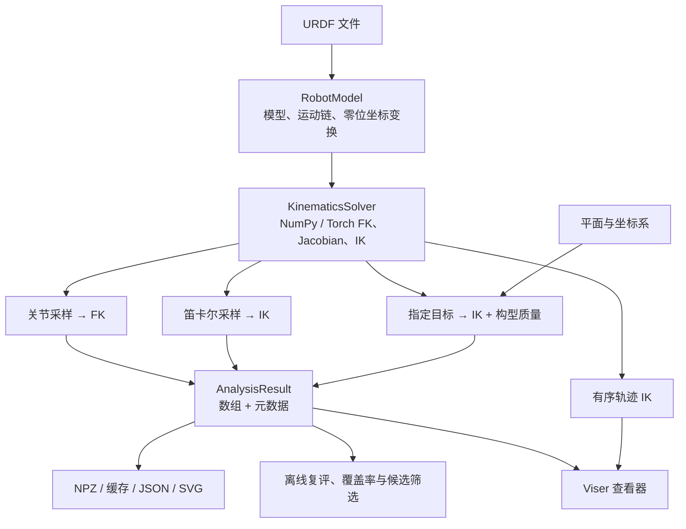

# 架构说明

[中文首页](../README.zh-CN.md) · [English](../README.md) · [Python API](python-api.md)

WorkspaceAnalyzer 是围绕 URDF 串联运动链的数值分析库。
核心任务是从模型算出位置、Jacobian、IK 和可达性，再将测量数据保存或显示。
分析代码不依赖机器人控制器、ROS、仿真器或浏览器服务。

## 数据如何流动



主 CLI 和示例负责组合这些能力，传递配置、管理文件和选择展示方式。
浏览器中的重算仍然调用相同的分析 API。

## 模块职责

| 层 | 模块 | 职责与边界 |
| --- | --- | --- |
| 模型 | `model.py` | 解析和校验 URDF 树，选择运动链，提供全树零位变换 |
| 求解 | `kinematics.py` | 批量 FK、几何 Jacobian、有界 DLS IK；保留后端数组和梯度 |
| 计算辅助 | `sampling.py`, `metrics.py`, `trajectory.py` | 采样、灵活度指标、顺序轨迹和连续性 |
| 分析 | `analyzer.py` | 关节 / 笛卡尔扫描，`AnalysisResult` 与 NPZ 读写 |
| 任务评估 | `reachability.py`, `plane.py` | 指定目标的 IK 与质量测量，平面几何和坐标系 |
| 派生分析 | `coverage.py`, `robustness.py`, `boundary.py`, `stability.py` | 姿态覆盖、扰动、区间细化、多次求解对照 |
| 候选分析 | `selection.py`, `diversity.py` | 已测构型的筛选、分组和来源追溯 |
| 结果服务 | `cache.py`, `acceptance.py`, `result_export.py`, `plane_plot.py` | 缓存、验收、独立导出和二维图 |
| 入口 | `cli.py`, `inspection.py`, `examples/` | 参数与路径校验，组装任务，返回退出状态 |
| 展示 | `visualization.py`, `plane_visualization.py` | 场景、GUI、播放与可取消的后台任务 |

`__init__.py` 暴露常用配置、求解器和分析入口。高级能力保留各自模块；
无需经过 CLI 或 viewer 就能调用。

## 保留的设计

**NumPy 核心，可选运行依赖。** 核心只需要 NumPy。
Torch、SciPy、Viser 和 trimesh 在对应功能中加载。显式选用 `numpy` 适合简单的
CPU 分析；Torch 适合需要 GPU 或自动求导的场景。两套数值路径的重复部分具有
后端差异，不引入通用后端类层次。

**测量与判定分开。** IK 收敛、构型质量和整次运行的验收是不同结果。
目标分析保留原始测量，质量门槛可以离线调整；`acceptance.py` 用成功率等条件
判定整次任务是否通过。候选解筛选只能使用已测构型，不能声称排除了其他分支。

**平面复用目标评估。** `plane.py` 定义采样和坐标变换，然后调用
`analyze_targets`。坐标系、IK、质量和报告保持一条计算路径。
`analyze_cartesian` 则提供不计算质量指标的轻量扫描，两者保留不同的成本和结果语义。

**结果是显式数组。** `AnalysisResult` 使用 NumPy 数组和元数据，适合存储、
缓存及离线分析；低层求解器保留 NumPy / Torch 原生对象。
NPZ 禁用 pickle，先校验后原子替换；CLI 的不同导出独立尝试，单份文件失败不丢弃其他诊断。
稳定性研究与边界追踪也复用原子写入；每份文件独立替换，多文件保存不构成整体事务。

## 做减法的边界

- 几何变换归模型层。平面扫描、全机器人展示和对比工具共用
  `RobotModel.zero_transforms()`，不各自遍历 URDF 树。
- 入口只组装配置。目标和平面模式共用 `ReachabilityConfig` 构造，避免默认值漂移。
- 导出直接调用 `save_result_artifacts`，用报告格式参数表达差异，省去单纯转发的模块。
- NPZ 与文本产物共用 `_atomic.py` 的临时文件、关闭与替换流程，统一处理中断清理。
- Tensor 到 NumPy 的测量转换共用 `_arrays.py`；调用者不再为一个转换函数依赖分析器。
- 计算层不反向导入 viewer。无界面工具无需因为读取模型坐标系而加载可视化模块。
- README 只放选择、安装、运行和结果含义。算法细节进入 API 指南；专项验证各有文档。

不为了缩短单个文件而机械拆分模块，也不为了统一少量表达式而增加插件注册表、
配置继承或新的框架。优先消除具有相同语义的重复实现。

## 需要留意的耦合

`AnalysisResult` 与分析器目前同在 `analyzer.py`，因此缓存和离线分析也会导入该模块。
结果对象的质量复评、姿态覆盖等便利方法使用局部导入，避免模块初始化时形成循环。
这是可见且有限的耦合；拆出结果模块应有独立的使用需求，而不是单纯搬代码。

Viser 的场景更新、轨迹播放、后台求解共享状态。
查看器负责锁和任务取消，平面面板负责平面配置与导出状态。
创建服务前校验配置；初始化失败只释放本实例启动的服务，共享服务由调用方管理。
CLI 和示例通过已有的 `with ViserWorkspace(...)` 管理查看器，共享对比也遵循同一退出路径。
改变参考配置或切换实验会使旧任务失效；关闭服务后，迟到结果不能再发布。
修改这一层时，单独验证正常完成、取消、失败重试和关闭过程。

## 如何验证修改

```bash
make lint
make test
make test-workflow
make build
```

数值修改需要独立的 FK / Jacobian / IK 误差检查，并覆盖 NumPy、Torch 和两种精度。
真实模型测试使用外部资产，`make test-robot` 在缺少资产时直接失败。
浏览器测试需要本地 socket 权限；被环境跳过不能作为界面已验证的证据。
依赖与 CI 约定见 [CONTRIBUTING.md](../CONTRIBUTING.md)，
报告、退出码和复现见[测试工作流](testing-workflow.md)。
